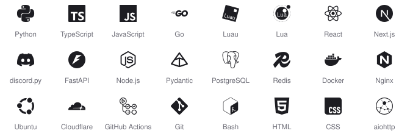

<picture>
  <source media="(prefers-color-scheme: dark)" srcset="assets/typing-dark.svg">
  
</picture>

full-stack developer building discord bots, web apps and the infrastructure that runs them. i take a product from the first commit to the server it lives on: the backend, the frontend, the database, the deploys and the monitoring.

[coy.baby](https://coy.baby) &nbsp;&nbsp; [chat](https://coy.baby/#contact) &nbsp;&nbsp; [email](mailto:glumly@fray.lol)

#### projects

- **[fray](https://fray.lol)**: a free discord bot and user app with social reposts, roblox and game lookups, moderation, tickets, leveling, ai, 15 languages and a web dashboard.
- **[feign](https://feign.lol)**: a discord bot and site with over 100,000 users.
- **[pout](https://pout.lol)**: avatar tools for discord: autopfp, avatar history and server setup.
- **[unripe](https://github.com/ashfall-sh/unripe)**: fails the build when a locked dependency is newer than you trust. one check for npm, pnpm, yarn, bun, pypi, cargo, go, composer and rubygems.
- **[mintsearch](https://github.com/ashfall-sh/mintsearch)**: search, a sitemap and llms.txt for self-hosted Mintlify docs.

all of it is built under [ashfall](https://github.com/ashfall-sh).

#### stack

<picture>
  <source media="(prefers-color-scheme: dark)" srcset="assets/strip-dark.svg">
  
</picture>

  

