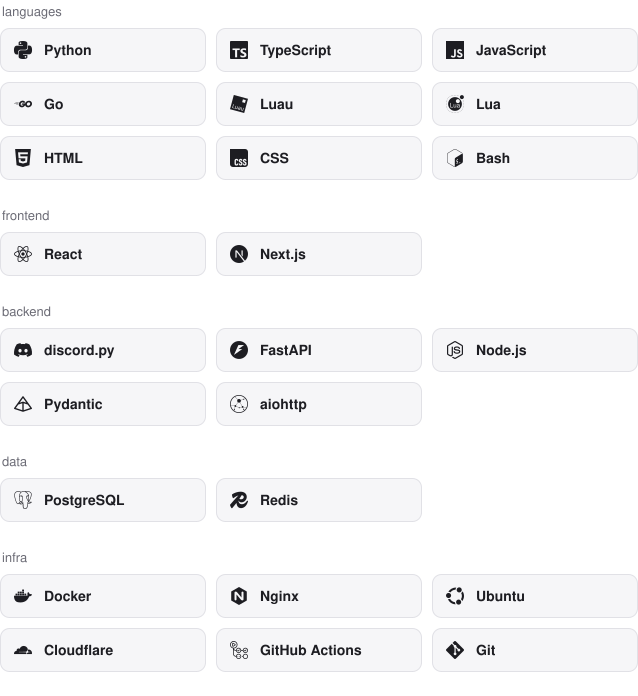

full-stack developer building discord bots, web apps and the infrastructure that runs them. i take a product from the first commit to the server it lives on: the backend, the frontend, the database, the deploys and the monitoring.

[fray.lol](https://fray.lol) &nbsp;&nbsp; [docs](https://docs.fray.lol) &nbsp;&nbsp; [email](mailto:glumly@fray.lol)

### things i've built

**[fray](https://fray.lol)** a free discord bot and user app with social reposts, roblox and game lookups, moderation, tickets, leveling, ai, 15 languages and a web dashboard. built with python, discord.py, fastapi, postgresql, redis and next.js, self-hosted on docker.

**[feign](https://feign.lol)** a discord bot and site with over 100,000 users.

**[unripe](https://github.com/glumly/unripe)** fails the build when a locked dependency is newer than you trust. one check for npm, pnpm, yarn, bun, pypi, cargo, go, composer and rubygems lockfiles.

### stack

<picture>
  <source media="(prefers-color-scheme: dark)" srcset="assets/stack-dark.svg">
  
</picture>
